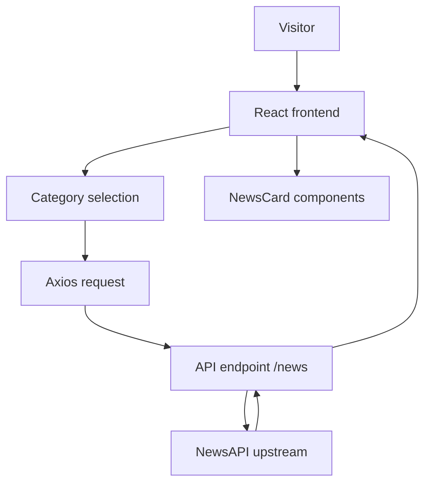

# Architecture

## Current implementation
- `src/App.js` manages selected category and requests articles from a fixed localhost URL.
- `src/component/Cards/newsCard.jsx` renders each article.
- `api/index.js` is intended to proxy NewsAPI requests and read `NEWS_API_KEY` from the server environment.

## Integration gap
The API folder is source code only. The package manifest does not declare Express or provide an API startup script. The frontend is not configured for a remote API origin.
